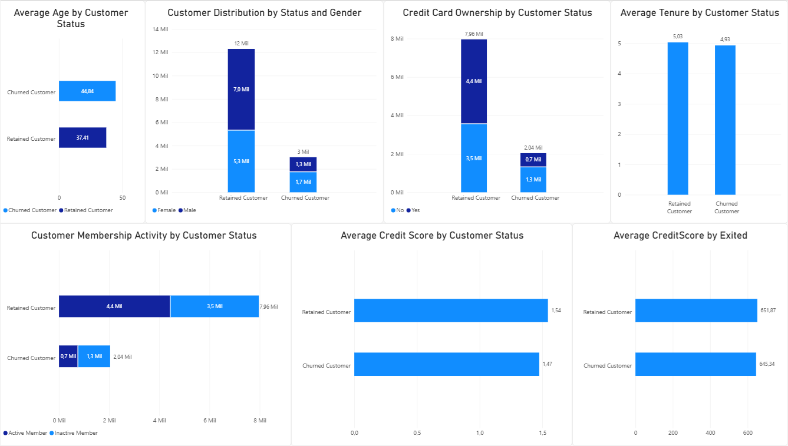
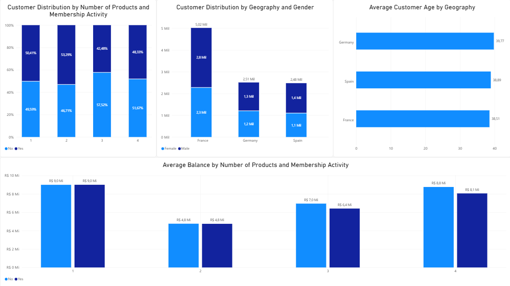
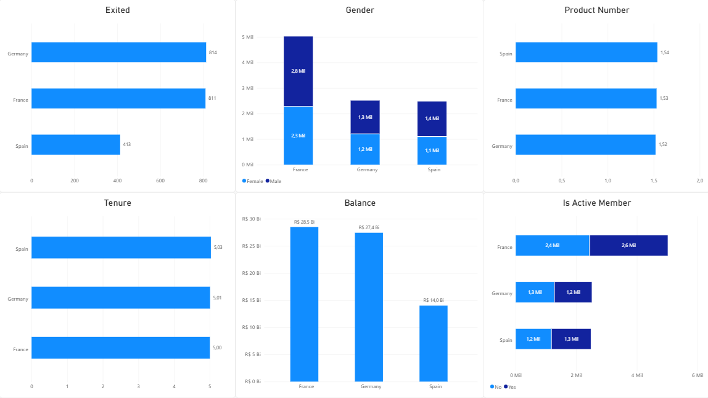

# Bank Customer Churn Analysis | Power BI

## Project Overview

This project analyzes customer churn in a banking institution, exploring customer characteristics, demographic profiles, and behavioral patterns to identify factors associated with customer retention and churn.

The analysis was developed using Microsoft Power BI, with data preparation and transformation performed in Power Query and additional calculations created using DAX.

## Objectives

The main objectives of this project are:

- Identify the characteristics most commonly associated with customers who leave the bank.
- Understand the demographic profile of the customer base.
- Compare customer behavior across France, Germany, and Spain.
- Identify customer segments based on product ownership and membership activity.

## Tools & Technologies

- Microsoft Power BI
- Power Query
- DAX

## Data Sources

- Bank Customer Churn dataset.

## Project Structure

The project is organized into three analytical pages:

1. **Customer Profile & Churn Analysis** — Examines differences between customers who left the bank and those who remained.
2. **Demographic Customer Profile and Segment** — Explores customer demographics, geography, product ownership, and membership activity.
3. **Difference Between Customers** — Compares customer characteristics and behavior across the three countries.

## Data Preparation & Modeling

The dataset was prepared and transformed using Power Query.

The analysis included data type adjustments, column organization, and the creation of calculated columns and measures using DAX.

A customer status classification was also created to distinguish between churned and retained customers, allowing a consistent comparison throughout the dashboard.

## Key Findings

- **Age:** Churned customers had a higher average age (44.84 years) than retained customers (37.41 years).
- **Membership Activity:** Inactive membership was more common among churned customers, indicating a relevant association with customer retention.
- **Credit Card Ownership:** Approximately 63.89% of churned customers did not have a credit card, compared with 44.55% of retained customers.
- **Geographic Distribution:** France had the largest customer base, with approximately 5,020 customers, followed by Germany and Spain.
- **Customer Segmentation:** Differences in product ownership and membership activity revealed distinct customer segments.

These findings highlight differences between retained and churned customers and provide insights that may support customer retention strategies.

## Dashboard Preview

### Customer Profile & Churn Analysis

### Demographic Customer Profile and Segment

### Difference Between Customers

## Project Conclusion

For the complete project conclusion in English and Portuguese, see:

[Bank Customer Churn - Project Conclusion](Bank-Customer-Churn-Conclusion.md)

---

Project developed using Microsoft Power BI.
